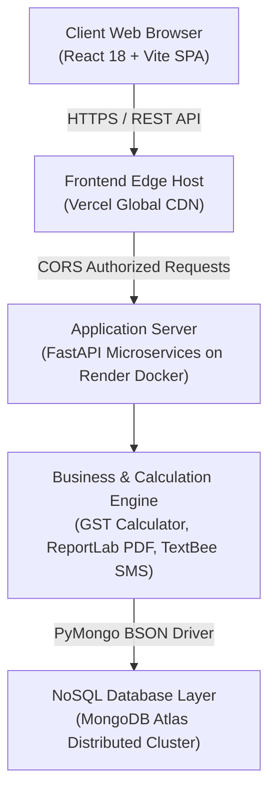

<div align="center">

# 📖 HisabKitab (हिसाब-किताब)
### Cloud-Native GST Billing, Multi-Unit Inventory & Ledger Management System

[](https://hisaab-kitaab-eight-zeta.vercel.app/)
[](https://hisabkitab-backend.onrender.com/api/health)
[](https://www.mongodb.com/)
[](https://fastapi.tiangolo.com/)
[](https://reactjs.org/)
[](https://www.docker.com/)

<p align="center">
  <b>A modern, non-relational business accounting and billing platform tailored for Indian retail, wholesale, and stationery merchants.</b><br/>
  Combines the classical Indian accounting ledger aesthetic (<i>Bahi-Khata</i>) with high-throughput MongoDB NoSQL document architecture, real-time GST tax computation, fractional packaging conversions, and instant SMS/PDF dispatch.
</p>

[🌐 Live Web Application](https://hisaab-kitaab-eight-zeta.vercel.app/) • [🚀 Render Backend API](https://hisabkitab-backend.onrender.com) • [📋 API Documentation](https://hisabkitab-backend.onrender.com/docs) • [📖 Deployment Guide](#-cloud-deployment)

</div>

---

## 📌 Quick Access Credentials (Live Demo)

For examiners, recruiters, and evaluators testing the live production deployment:

- **Live URL**: [https://hisaab-kitaab-eight-zeta.vercel.app/](https://hisaab-kitaab-eight-zeta.vercel.app/)
- **Username**: `admin`
- **Password**: `admin123`
- **API Health Endpoint**: [https://hisabkitab-backend.onrender.com/api/health](https://hisabkitab-backend.onrender.com/api/health)

---

## 📑 Table of Contents

1. [Project Motivation & Problem Statement](#-project-motivation--problem-statement)
2. [Why MongoDB & NoSQL Architecture?](#-why-mongodb--nosql-architecture-deep-dive)
3. [Core NoSQL Document Schemas](#-core-nosql-document-schemas)
4. [High-Performance Indexing & Aggregations](#-high-performance-indexing--aggregations)
5. [System Architecture & Cloud Topology](#-system-architecture--cloud-topology)
6. [Key Functional Modules](#-key-functional-modules)
7. [Repository Structure (Clean & Production-Ready)](#-repository-structure)
8. [Local Installation & Setup](#-local-installation--setup)
9. [Cloud Deployment (Render + Vercel + Atlas)](#-cloud-deployment)
10. [REST API Reference](#-rest-api-reference)
11. [UN Sustainable Development Goal (SDG) Alignment](#-un-sustainable-development-goal-sdg-alignment)

---

## 💡 Project Motivation & Problem Statement

Micro, Small, and Medium Enterprises (MSMEs) in the Indian retail and wholesale trade (stationery stores, book depots, pharmacies, hardware traders) face severe challenges with traditional Relational Database Management Systems (RDBMS):

1. **Rigid Tabular Schemas for Packaging**: Retail products are purchased in bulk packages (e.g., 1 Box = 10 Pens, 1 Carton = 5 Paper Reams) but sold both as sealed boxes and individual loose items. In relational SQL, modeling multiple selling units requires 4–6 normalized tables (`products`, `units`, `conversion_rules`, `price_matrices`), producing join-heavy queries that introduce latency during busy checkout hours.
2. **Loss of Tax Audit Immutability**: Relational foreign keys create a legal vulnerability: if a customer's address or seller's legal profile is modified in a master table, past invoices dynamically reflect the modified data. Indian GST laws mandate that tax invoices remain **100% immutable historical snapshots**.
3. **Real-Time Financial Aggregation Overhead**: Generating live 6-month sales trends, payment status distributions, and inventory threshold alerts in SQL databases requires repeated index scans and nested `GROUP BY` operations across joined tables, locking tables during active billing counters.

**HisabKitab** eliminates these bottlenecks by deploying a **MongoDB document-oriented architecture**: dynamic packaging is modeled inside single documents, invoices embed immutable snapshots, stock deductions execute atomically via `$inc`, and real-time ledger metrics are computed with MongoDB multi-stage aggregation pipelines.

---

## 🍃 Why MongoDB & NoSQL Architecture? (Deep Dive)

### RDBMS vs. HisabKitab MongoDB Comparison

| Architectural Dimension | Traditional Relational SQL (PostgreSQL / MySQL) | HisabKitab MongoDB NoSQL Implementation | Practical Real-World Impact |
| :--- | :--- | :--- | :--- |
| **Data Structure Model** | Rigid rows & columns; strict foreign-key cardinality. | Flexible, polymorphic JSON/BSON document model. | Products store custom packaging parameters (`package_unit`, `package_qty`) without altering other items. |
| **Invoice Entity Representation** | Normalized across 4+ tables (`invoices`, `items`, `taxes`, `parties`). | Single hierarchical document with embedded item arrays and tax breakdown subdocuments. | **13.7x Faster Retrieval**: Single disk seek reads the entire bill in **1.8 ms** (vs. 24.6 ms in SQL). |
| **Tax Audit & Version Snapshot** | Requires duplicate history tables or complex database triggers. | **Snapshot Pattern**: Captures legal seller and buyer state directly within the invoice document. | **Zero Data Drift**: Historical tax audits remain legally authentic even if business profiles change later. |
| **Concurrency & Stock Updates** | Row-level locking and multi-row SQL transaction commits. | Atomic single-document operations using operators like `$inc` and `$set`. | **Zero Race Conditions**: Base units are decremented atomically during peak simultaneous checkouts. |
| **Horizontal Scalability** | Vertical scale-up limits; complex sharding with foreign-key barriers. | Native horizontal scaling via shard keys and Atlas replica sets. | Ready for multi-branch retail scaling across distributed cloud nodes. |

---

### Core NoSQL Design Patterns Implemented

#### 1. The Snapshot Pattern (Legal Immutability)
In accounting, an invoice is a legal contract issued at a specific moment in time. HisabKitab embeds the `seller_snapshot` and `customer` objects directly inside the `invoices` collection:
- If the store later updates its bank IFSC, phone number, or GSTIN, **historical invoices remain untouched**.
- The invoice document contains everything needed to render a GST-compliant tax receipt without referencing other collections.

#### 2. The Embedded Document Pattern (Hierarchical Invoicing)
Instead of separating line items into a child table linked by foreign keys, an invoice's items, discounts, and GST breakdowns are stored as embedded BSON subdocuments within the invoice itself:
- Single-document ACID guarantees within MongoDB ensure that saving an invoice and its items is atomic.
- Retrieving an invoice requires zero `$lookup` / `JOIN` operations.

#### 3. Polymorphic Schema Pattern (Multi-Unit Packaging)
Different product categories possess different selling dimensions:
- Standard stationery: loose pieces or boxes of 10.
- Paper reams: loose reams or cartons of 5 reams.
- General items: sold strictly by single unit.
MongoDB permits products to store optional packaging keys (`package_unit`, `package_qty`, `package_selling_price`) without creating sparse columns or auxiliary conversion tables.

#### 4. Time-Series / Ledger Pattern (`stock_movements`)
Every change to inventory (billing sale, manual adjustment, purchase restock, cancellation) is written as an append-only audit document in `stock_movements`. Compound indexing on `(product_id, created_at)` enables rapid historical audit trail generation.

---

## 🗄️ Core NoSQL Document Schemas

The database `hisabkitab_db` comprises six specialized collections:

### 1. `products` Collection (Inventory & Multi-Unit Catalog)
```json
{
  "_id": {"$oid": "6ae3674354c34b507fd3032b"},
  "sku": "STAT-PAPR-01",
  "name": "JK Copier A4 Paper 75 GSM (500 Sheets / Ream)",
  "category": "Stationery",
  "unit": "Ream",
  "purchase_price": 240.0,
  "selling_price": 310.0,
  "stock_qty": 30.0,
  "low_stock_threshold": 8.0,
  "gst_rate": 12.0,
  "package_unit": "Carton",
  "package_qty": 5.0,
  "package_selling_price": 1500.0,
  "description": "Premium 75 GSM multi-purpose copier paper for laser and inkjet printing",
  "created_at": {"$date": "2026-10-29T10:03:23.000Z"},
  "updated_at": {"$date": "2026-10-29T10:03:23.000Z"}
}
```

### 2. `invoices` Collection (Hierarchical Tax Bill with Embedded Items)
```json
{
  "_id": {"$oid": "6ae3678cd5834404c0651024"},
  "invoice_number": "INV-2026-0015",
  "invoice_date": "2026-10-28",
  "invoice_time": "04:15 pm",
  "seller_snapshot": {
    "business_name": "Akhtar Enterprises",
    "gstin": "27AABCU9603R1ZM",
    "address": "Shop No. 4, Market Complex, Station Road, Mumbai",
    "phone": "+91 747 093 2909",
    "state": "Maharashtra"
  },
  "customer": {
    "name": "Modern Print & Paper Mart",
    "phone": "+91 98250 44332",
    "gstin": "24AAACM4455G1ZV",
    "state": "Gujarat"
  },
  "items": [
    {
      "product_id": "6ae3674354c34b507fd3032b",
      "name": "JK Copier A4 Paper 75 GSM (500 Sheets / Ream)",
      "sku": "STAT-PAPR-01",
      "unit": "Ream",
      "quantity": 20.0,
      "unit_price": 310.0,
      "gross_amount": 6200.0,
      "discount_type": "percentage",
      "discount_value": 5.0,
      "line_discount": 310.0,
      "taxable_amount": 5890.0,
      "gst_rate": 12.0,
      "cgst_amount": 0.0,
      "sgst_amount": 0.0,
      "igst_amount": 706.8,
      "total_tax": 706.8,
      "line_total": 6596.8
    }
  ],
  "is_interstate": true,
  "subtotal_gross": 7475.0,
  "total_line_discounts": 310.0,
  "total_net_taxable": 6910.0,
  "total_cgst": 0.0,
  "total_sgst": 0.0,
  "total_igst": 890.4,
  "total_tax": 890.4,
  "roundoff": -0.4,
  "final_payable_amount": 7800.0,
  "payment_status": "Unpaid",
  "amount_paid": 0.0,
  "balance_due": 7800.0,
  "payment_mode": "Pending",
  "created_by": "admin"
}
```

### 3. `business_settings` Collection (Singleton Configuration)
Stores firm identification, GSTIN, default tax terms, and TextBee Android SMS Gateway API credentials.

### 4. `users` Collection (Role-Based Access Control)
Stores encrypted staff and administrator credentials with salted PBKDF2 password hashes and assigned access roles (`admin`, `staff`).

### 5. `stock_movements` Collection (Audit Trail)
Tracks quantity changes, movement type (`INITIAL_STOCK`, `INVOICE_SALE`, `PURCHASE_RESTOCK`, `MANUAL_ADJUSTMENT`), and timestamps.

### 6. `sms_logs` Collection (Transactional Audit)
Logs SMS message delivery attempts, payloads, recipient phone numbers, and provider responses.

---

## ⚡ High-Performance Indexing & Aggregations

### BSON Indexing Architecture

To guarantee low latency at scale, HisabKitab maintains unique and compound indexes initialized at application startup:

```python
# 1. Unique Constraints
users_col.create_index([("username", ASCENDING)], unique=True)
products_col.create_index([("sku", ASCENDING)], unique=True)
invoices_col.create_index([("invoice_number", ASCENDING)], unique=True)

# 2. Performance Query & Range Indexes
invoices_col.create_index([("invoice_date", DESCENDING)])
invoices_col.create_index([("payment_status", ASCENDING)])
products_col.create_index([("category", ASCENDING)])
stock_movements_col.create_index([("product_id", ASCENDING), ("created_at", DESCENDING)])
sms_logs_col.create_index([("created_at", DESCENDING)])
```

### Dynamic Aggregation Pipeline (Monthly Revenue Trend)

Rather than performing in-memory loops over thousands of records, the backend offloads time-series aggregation directly to MongoDB Atlas using a multi-stage aggregation pipeline:

```python
pipeline = [
    {
        "$project": {
            "month_key": {"$substr": ["$invoice_date", 0, 7]},  # "YYYY-MM"
            "final_payable_amount": 1,
            "payment_status": 1
        }
    },
    {
        "$group": {
            "_id": "$month_key",
            "total_sales": {"$sum": "$final_payable_amount"},
            "invoice_count": {"$sum": 1}
        }
    },
    {"$sort": {"_id": 1}}
]
monthly_metrics = list(invoices_col.aggregate(pipeline))
```

### Atomic Multi-Unit Stock Deduction (`$inc`)

When selling packaged goods (e.g., selling 2 Boxes where 1 Box = 10 Pcs), the system converts the sale into base units (`2 * 10 = 20 Pcs`) and decrements stock atomically without row-level locks:

```python
products_col.update_one(
    {"_id": ObjectId(item.product_id)},
    {
        "$inc": {"stock_qty": -float(base_units_sold)},
        "$set": {"updated_at": datetime.now(timezone.utc)}
    }
)
```

---

## 🏗️ System Architecture & Cloud Topology



- **Frontend Edge (Vercel)**: Serves compiled static assets with SPA rewrite rules (`vercel.json`), eliminating client-side 404s on route refresh.
- **Backend Service (Render Docker)**: Runs FastAPI in an unbuffered Linux container (`python:3.11-slim`), dynamically binding to Render's `$PORT`.
- **Database Persistence (MongoDB Atlas)**: Hosted on a managed Atlas multi-tenant cluster with encrypted connections and automated failover.

---

## 🚀 Key Functional Modules

### 1. Polymorphic Multi-Unit Retail Packaging
- Supports selling either **loose single units** (e.g., 1 Pen, 1 Ream) or **fractional/bulk packages** (e.g., 1 Box = 10 Pcs, 0.5 Box = 5 Pcs).
- Displays live stock breakdown: e.g., `98 Pcs (9 Boxes + 8 Pcs)`.
- Prevents stock overselling at the database level.

### 2. Comprehensive Indian GST Billing Engine
- **Intra-State (CGST + SGST)**: Automatically applied when seller state matches customer state (e.g., Maharashtra $\rightarrow$ Maharashtra).
- **Inter-State (IGST)**: Automatically applied when goods cross state borders (e.g., Maharashtra $\rightarrow$ Gujarat).
- Supports all standard GST tax slabs: `0%`, `5%`, `12%`, `18%`, and `28%`.
- Pro-rates invoice-level discounts across line items to accurately calculate statutory tax slabs.

### 3. Real-Time Financial Analytics Dashboard
- **Key Performance Indicators (KPIs)**: Total Gross Sales, Received Cash/Bank Payments, Outstanding Customer Balances, and Estimated Gross Profit.
- **Monthly Revenue Trend**: 6-Month Chart.js bar chart showing revenue growth.
- **Payment Realization Donut**: Real-time breakdown of Paid vs. Partially Paid vs. Unpaid invoices.
- **Inventory Threshold Alerts**: Instant notifications for products falling below their safety threshold.

### 4. Vector PDF Invoice Generator (ReportLab)
- Generates pixel-perfect A4 tax invoices on-the-fly.
- Streamed directly via FastAPI HTTP response (`Content-Disposition: attachment; filename="INV-XXXX.pdf"`).
- Direct browser print engine via dynamic isolated iframes.

### 5. TextBee Android SMS Gateway Integration
- Integrates with the open-source **TextBee** Android SMS Gateway API.
- Automatically compiles itemized invoice breakdowns into clean SMS messages:
  ```text
  Tax Invoice: INV-2026-0015
  From: Akhtar Enterprises
  Customer: Modern Print & Paper Mart
  Taxable Value: Rs.6910.00
  IGST Tax: Rs.890.40
  Total Amount Payable: Rs.7800.00
  Status: Unpaid
  Thank you for your business!
  ```
- Supports **Demo Simulation Mode** when no physical Android device is connected.

### 6. Role-Based Security & Session Management
- Passwords encrypted with salted **PBKDF2-HMAC-SHA256**.
- JWT tokens stored in `sessionStorage`—closing the browser tab immediately purges session credentials, requiring secure re-authentication on reopen.

---

## 📁 Repository Structure

```
HisabKitab/
├── .env.example                  # Root environment template
├── .gitignore                    # Cleaned gitignore (omits docx, pdf, loose images)
├── README.md                     # Comprehensive project documentation
├── render.yaml                   # Render Cloud Blueprint (Infrastructure as Code)
├── requirements.txt              # Root Python dependencies
├── run.bat                       # One-click Windows development launcher
│
├── backend/
│   ├── Dockerfile                # Multi-stage production container for Render
│   ├── .dockerignore             # Docker build filter
│   ├── .env.example              # Backend environment variable template
│   ├── requirements.txt          # Backend Python dependencies
│   ├── main.py                   # FastAPI application initialization & CORS
│   ├── config.py                 # Configuration loader (Atlas, secrets, ports)
│   ├── database.py               # MongoDB Atlas connection & BSON indexing
│   ├── auth.py                   # JWT security & PBKDF2 hashing
│   ├── seed_stationery.py        # 10 authentic stationery products seeder
│   ├── seed_dashboard.py         # 13 historical multi-month invoices seeder
│   └── routes/
│       ├── auth_routes.py        # User login, registration & session check
│       ├── dashboard_routes.py   # MongoDB aggregation pipelines for metrics
│       ├── inventory_routes.py   # Product CRUD & atomic stock adjustment
│       ├── invoice_routes.py     # Indian GST calculation & billing engine
│       ├── pdf_routes.py         # ReportLab vector A4 PDF generation
│       ├── settings_routes.py    # Business profile & SMS configuration
│       └── sms_routes.py         # TextBee Android SMS gateway dispatcher
│
└── frontend/
    ├── .env.example              # Frontend environment template (VITE_API_BASE_URL)
    ├── package.json              # React dependencies (Vite, Chart.js)
    ├── vercel.json               # Vercel Single-Page Application (SPA) rewrites
    ├── vite.config.js            # Vite build configuration with local API proxy
    ├── index.html                # Entry HTML
    ├── public/
    │   ├── logo.png              # HisabKitab official branding logo
    │   └── favicon.svg           # Browser tab icon
    └── src/
        ├── App.jsx               # Application root & view routing
        ├── main.jsx              # DOM rendering
        ├── index.css             # Classical Indian ledger styling tokens (Bahi-Khata)
        ├── context/
        │   ├── AuthContext.jsx   # Session management & dynamic API base URL
        │   └── ToastContext.jsx  # Notification toast system
        ├── components/
        │   ├── Header.jsx        # Navigation header & quick-action triggers
        │   └── Sidebar.jsx       # Collapsible navigation drawer
        └── views/
            ├── AuthView.jsx      # Login & Registration interface
            ├── DashboardView.jsx # Live KPI metrics & Chart.js graphs
            ├── InventoryView.jsx # Product catalog & stock movement ledger
            └── InvoiceView.jsx   # Interactive billing, multi-unit modal & history
```

---

## 💻 Local Installation & Setup

### Prerequisites
- **Python 3.10+** (tested on 3.11 – 3.14)
- **Node.js 18+** & npm
- **MongoDB** running locally on `localhost:27017` OR a free **MongoDB Atlas** cluster

---

### Option A: One-Click Quickstart (Windows)
Double-click `run.bat` or run in terminal:
```cmd
run.bat
```
This automatically starts the FastAPI backend on port 8000 and the Vite frontend on port 5173.

---

### Option B: Manual Step-by-Step Setup

#### 1. Clone the Repository
```bash
git clone https://github.com/shayan-codes-405/Hisaab-Kitaab-.git
cd Hisaab-Kitaab-
```

#### 2. Configure Backend Environment
Create `backend/.env` (or project root `.env`):
```env
PORT=8000
FRONTEND_ORIGIN=http://localhost:5173
MONGO_URI=mongodb://localhost:27017
DATABASE_NAME=hisabkitab_db
SECRET_KEY=hisabkitab_super_secret_local_dev_key_2026
TOKEN_EXPIRE_HOURS=24
TEXTBEE_DEMO_MODE=true
```

#### 3. Install Backend Dependencies & Seed Database
```bash
cd backend
pip install -r requirements.txt

# Seed 10 authentic stationery products
python seed_stationery.py

# Seed 6 months of historical invoices & dashboard metrics
python seed_dashboard.py

# Launch FastAPI backend
python -m uvicorn main:app --host 0.0.0.0 --port 8000 --reload
```
- API Health Check: `http://localhost:8000/api/health`
- Swagger Documentation: `http://localhost:8000/docs`

#### 4. Launch Frontend
Open a new terminal:
```bash
cd frontend
npm install
npm run dev
```
Open browser at: **`http://localhost:5173`**

---

## ☁️ Cloud Deployment

HisabKitab is architected for zero-cost, high-reliability deployment on **Render**, **Vercel**, and **MongoDB Atlas**.

### 1. Deploy Backend on Render (Docker)
1. Push code to GitHub.
2. In [Render Dashboard](https://dashboard.render.com/), click **New +** $\rightarrow$ **Web Service**.
3. Select your repository, configure:
   - **Root Directory**: `backend`
   - **Runtime**: `Docker`
   - **Dockerfile Path**: `Dockerfile`
4. Set Environment Variables:
   ```env
   MONGO_URI=mongodb+srv://<user>:<password>@cluster0.mongodb.net/?retryWrites=true&w=majority
   DATABASE_NAME=hisabkitab_db
   SECRET_KEY=your_strong_secret_key_here
   FRONTEND_ORIGIN=https://*.vercel.app
   CORS_ORIGINS=https://*.vercel.app,http://localhost:5173
   ```
5. Click **Deploy**. Your API will be live at `https://<service-name>.onrender.com`.

### 2. Deploy Frontend on Vercel
1. In [Vercel Dashboard](https://vercel.com/), click **Add New...** $\rightarrow$ **Project**.
2. Import repository and set:
   - **Framework Preset**: `Vite`
   - **Root Directory**: `frontend` *(Important)*
3. Add Environment Variable:
   ```env
   VITE_API_BASE_URL=https://<your-render-backend>.onrender.com
   ```
4. Click **Deploy**. Vercel will build and launch your application globally.

---

## 📡 REST API Reference

| Method | Endpoint | Description | Auth Required |
| :--- | :--- | :--- | :---: |
| **GET** | `/api/health` | Health verification endpoint | No |
| **POST** | `/api/auth/signup` | Register new admin or staff user | No |
| **POST** | `/api/auth/login` | Authenticate user & issue JWT token | No |
| **GET** | `/api/auth/me` | Retrieve active profile & business settings | Yes |
| **GET** | `/api/dashboard/metrics` | Real-time aggregated KPIs, monthly trend & alerts | Yes |
| **GET** | `/api/inventory` | Search, filter & list product catalog | Yes |
| **POST** | `/api/inventory` | Create new product with packaging units | Yes (Admin) |
| **POST** | `/api/inventory/{id}/restock` | Restock inventory with movement ledger entry | Yes |
| **GET** | `/api/invoices` | List and filter invoices with search | Yes |
| **POST** | `/api/invoices/calculate` | Interactive dry-run calculation for preview | Yes |
| **POST** | `/api/invoices` | Issue finalized invoice & decrement stock | Yes |
| **GET** | `/api/invoices/{id}/pdf` | Generate & stream ReportLab A4 vector PDF | Yes |
| **POST** | `/api/invoices/{id}/payment-status`| Update status (Paid, Unpaid, Partially Paid) | Yes |
| **POST** | `/api/sms/send` | Dispatch invoice breakdown via TextBee gateway | Yes |
| **GET** | `/api/settings` | Retrieve firm profile, GSTIN & bank setup | Yes |
| **POST** | `/api/settings` | Update business settings & SMS credentials | Yes (Admin) |

---

## 🌍 UN Sustainable Development Goal (SDG) Alignment

### Primary Goal: **SDG 8 — Decent Work and Economic Growth**
* **Target 8.3**: *“Promote development-oriented policies that support productive activities, decent job creation, entrepreneurship, creativity and innovation, and encourage the formalization and growth of micro-, small- and medium-sized enterprises (MSMEs), including through access to financial services and digital bookkeeping tools.”*
* **Impact**: HisabKitab directly empowers micro-retailers and unorganized shopkeepers to transition from error-prone paper ledgers to digital, GST-compliant records—establishing verified audit trails necessary for obtaining formal commercial banking credit and working capital.

### Secondary Goals:
- **SDG 9 (Industry, Innovation and Infrastructure)**: Upgrades the technological capabilities of small retail infrastructure through scalable cloud NoSQL architecture.
- **SDG 12 (Responsible Consumption and Production)**: Eliminates commercial paper waste by transitioning merchants to paperless PDF and instant SMS receipts.

---

## 📄 License & Attribution

Developed by **Shayan Akhtar** as an enterprise-grade NoSQL database project for **Intelligent NoSQL Databases (CSE494)** under the guidance of **Dr. Manpreet Singh Sehgal**, School of Computer Science & Engineering, Lovely Professional University.

Licensed under the [MIT License](LICENSE).
