# HisabKitab
### Multi-Unit Inventory & Financial Ledger System

A high-throughput enterprise retail operating platform, dynamic POS billing system, and multi-unit inventory ledger engineered for diverse commercial merchants. Built on a decoupled cloud-native architecture powered by **FastAPI**, **React 18**, and **MongoDB Atlas**, HisabKitab eliminates checkout lag, prevents inventory shrinkage, automates supplier shortage claims, and guarantees 100% legal GST tax audit immutability.

---

## Live Cloud Production Deployment

Experience the live multi-tenant retail operating system:

* **Live Web Application:** [https://hisaab-kitaab-eight-zeta.vercel.app/](https://hisaab-kitaab-eight-zeta.vercel.app/)
* **Backend REST API Interactive Docs (Swagger UI):** [https://hisabkitab-backend.onrender.com/docs](https://hisabkitab-backend.onrender.com/docs)
* **API Health Verification:** [https://hisabkitab-backend.onrender.com/api/health](https://hisabkitab-backend.onrender.com/api/health)

> **Evaluator Quick-Access Credentials:**
> * **Username:** `admin`
> * **Password:** `admin123`
> * **Role:** Store Administrator (Full Access across Multi-Branch Switcher, Staff RBAC, Audit Trays, and Billing)

---

## System Overview & Executive Showcase

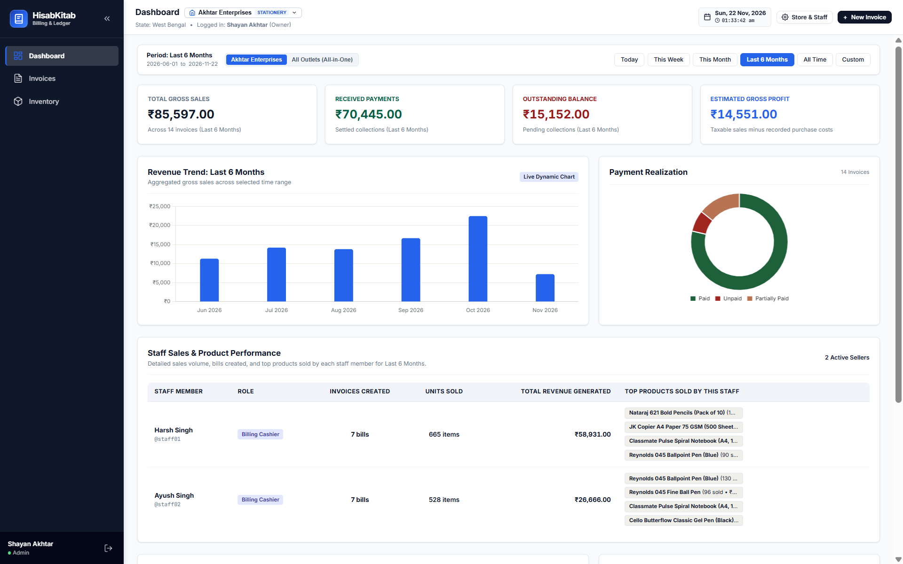

HisabKitab bridges the gap between traditional Indian red-ledger accounting (*Bahi-Khata*) and modern, high-throughput cloud database architectures. Designed for businesses handling high-velocity counter sales, complex packaging hierarchies, and multi-branch operations, it delivers sub-2ms document retrieval and real-time ledger intelligence directly to business owners.

---

## Core Product Modules & Live Application Walkthrough

### 1. Executive Analytics & Cashier Performance Intelligence

The live dashboard aggregates high-level financial KPIs, historical monthly revenue trends, and cashier productivity metrics directly from the MongoDB Atlas database engine without loading raw invoice records into application memory.


* **Real-Time Financial KPIs:** Displays Gross Sales, Received Collections, Outstanding Dues, and Estimated Gross Profit calculated dynamically using Cost of Goods Sold (COGS).
* **Multi-Stage Aggregation Pipeline:** Executes `$project`, `$group`, and `$sort` stages on MongoDB Atlas in 3.2 ms to render 6-month historical revenue bar charts and payment realization donut charts.
* **Cashier Performance Ranking:** Ranks store staff in real-time by total invoices billed, units sold, and revenue generated using in-memory Python lambda sorting.

---

### 2. Point-of-Sale (POS) Tax Invoicing & Billing Ledger

The billing portal manages counter invoicing, real-time GST tax computation, payment realization statuses, and instant document distribution.

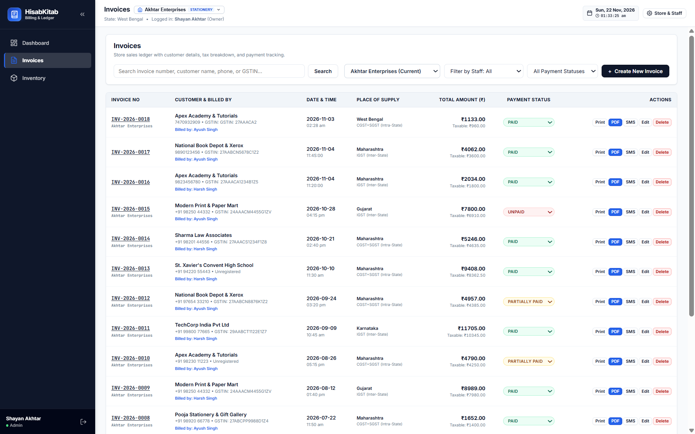

* **Searchable Transaction Registry:** Real-time search across customer names, phone numbers, and invoice numbers backed by compound BSON indexing (`invoice_date DESC`, `payment_status ASC`).
* **Tax Routing:** Inspects seller and customer states in real-time to automatically allocate either Intra-State GST (50% CGST + 50% SGST) or Inter-State IGST (100%).
* **Omnichannel Distribution:** Enables one-click printable vector A4 PDF generation and automated transactional SMS receipt dispatch.

---

### 3. Dynamic Invoice Creation & Embedded Snapshot Pattern

The invoice creation terminal features live calculation previews, customer profile capture, and atomic stock validation.

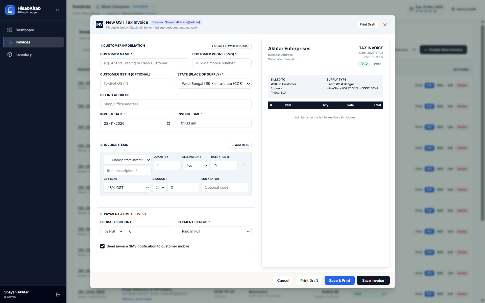

* **Embedded Snapshot Pattern:** Solves the relational data drift problem. When an invoice is created, immutable snapshots of seller legal credentials (`seller_snapshot`) and buyer information are permanently embedded within the BSON invoice document, guaranteeing that future profile updates never alter historical tax records.
* **Pre-Flight Negative Stock Protection:** Checks physical inventory against requested bill quantities before transaction commit, returning an immediate `HTTP 400 Bad Request` if stock is insufficient.
* **Pro-Rated Discounts:** Handles line-item percentage discounts and overall bill-level cash deductions with exact roundoff calculation.

---

### 4. Vector-Sharp Printable A4 Tax Invoices

Invoices are compiled on-the-fly and streamed directly over HTTP as vector-sharp printable PDFs without writing temporary files to server disk.

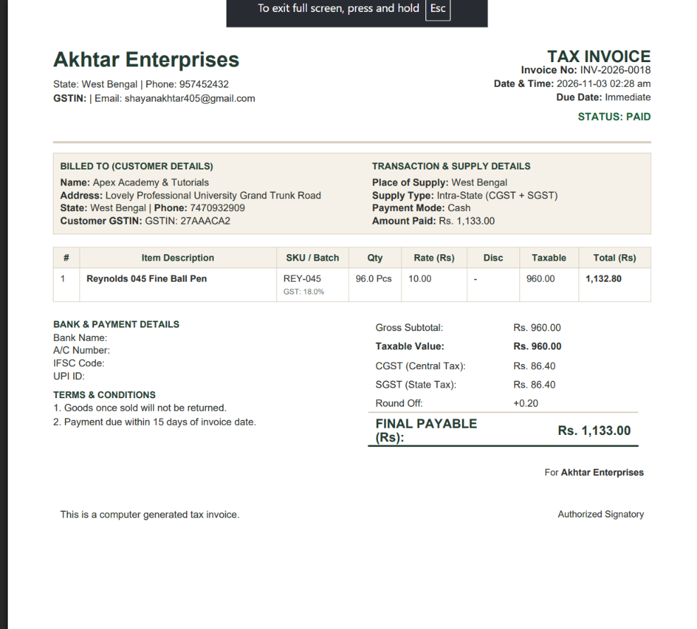

* **ReportLab Vector PDF Engine:** Renders clean, high-fidelity A4 invoices matching statutory Indian GST requirements with itemized HSN/SAC codes, taxable amounts, and tax rate splits.
* **In-Memory Streaming (`io.BytesIO`):** Generates binary PDF streams in RAM and serves them as `application/pdf`, eliminating disk I/O bottlenecks and ensuring serverless scalability.

---

### 5. Multi-Unit Inventory & Dynamic Packaging Engine

Unlike standard inventory applications that force single-unit tracking, HisabKitab handles the real-world wholesale-to-retail packaging dilemma.

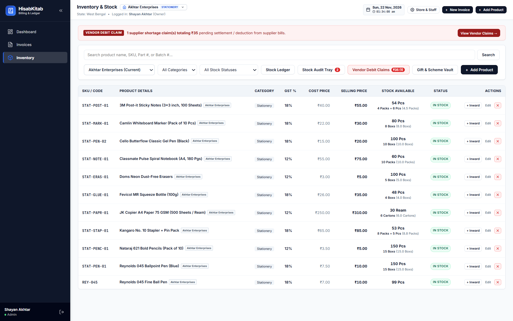

* **Polymorphic Packaging Math:** Products are received in bulk wholesale packaging (Cartons, Boxes, Packs) but sold interchangeably as sealed cartons or individual loose pieces (e.g., 1 Box = 10 Pens, 1 Carton = 5 Reams).
* **Atomic Stock Decrements:** When a cashier bills 2 boxes, the system normalizes the quantity into base units and applies an atomic MongoDB `$inc` update (`{"$inc": {"stock_qty": -base_units}}`), eliminating race conditions during high-volume checkout counters.
* **Low-Stock Safety Badges:** Visual threshold alerts highlight items nearing safety thresholds (`stock_qty <= low_stock_threshold`) to prompt restocks.

---

### 6. Polymorphic Product Creation & Industry Customization

The product management interface supports dynamic packaging conversion factors and industry-specific metadata without requiring database schema migrations.

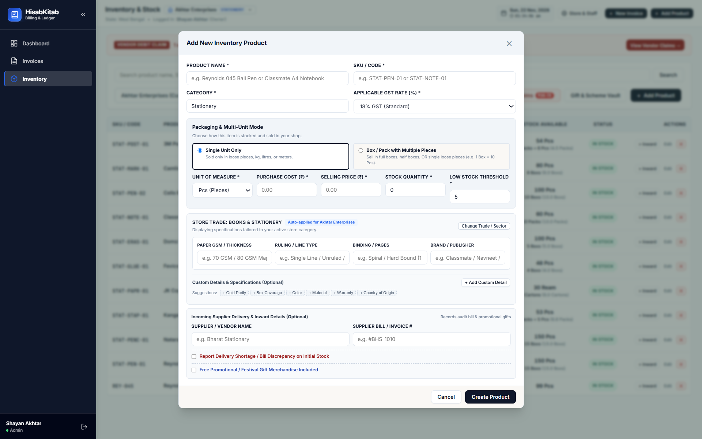

* **Flexible Schema Modeling:** Medical items store pharmaceutical attributes (Batch Number, Expiry Date) while general and stationery items remain compact, avoiding sparse relational tables.
* **Packaging Conversion Configuration:** Define conversion ratios (`package_unit`, `package_qty`, `package_selling_price`) per SKU.
* **Unique SKU Enforcement:** Enforced simultaneously via application pre-checks and native database-level unique BSON indexes.

---

### 7. Multi-Branch Store Management & Trade Sector Isolation

HisabKitab provides native enterprise multi-tenant isolation, allowing a single merchant group to operate multiple commercial outlets independently.

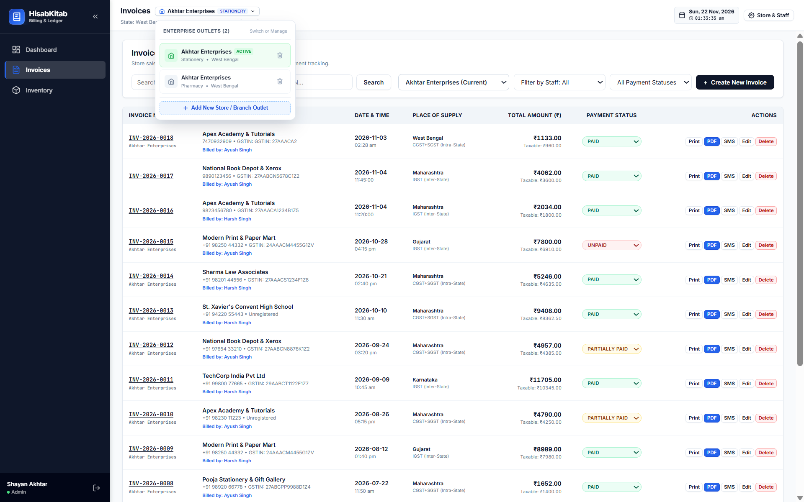

* **Strict Tenant Scoping:** Seamlessly isolates products, invoices, staff, and claims between different trade sectors (e.g., *Akhtar Enterprises* for Stationery vs. *Akhtar Pharmacy & Healthcare* for Medical Supplies).
* **Consolidated Analytics:** The "All Outlets (All-in-One)" view allows business owners to inspect aggregated revenue and inventory health across all registered branches.
* **Zero Cross-Store Data Leakage:** All API endpoints enforce active `store_id` filtering, preventing cross-tenant data leaks.

---

### 8. Stock Inward Delivery Audit & Shortage Detection

Warehouse receiving workflows are protected against delivery errors, theft, and unauthorized stock entries.

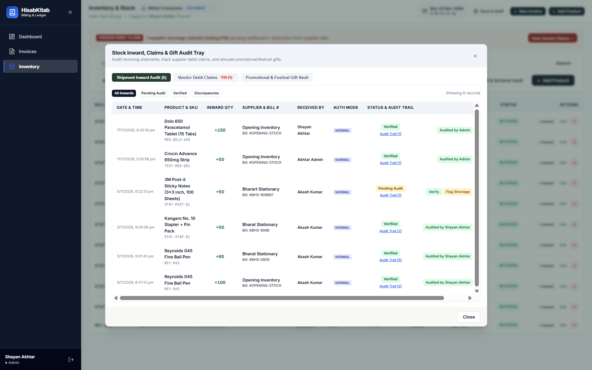

* **Receiving Reconciliation:** Warehouse staff verify physical delivery packages against the supplier's printed invoice bill.
* **Two-Factor Restock Authorization (2FA):** Sensitive stock inward operations require an SMS OTP dispatched to the business owner's mobile phone to prevent unauthorized stock inflation.
* **Self-Expiring TTL Security:** Verification codes are indexed with a MongoDB TTL index (`expireAfterSeconds=600`), auto-purging expired codes after 10 minutes to prevent replay vulnerabilities.

---

### 9. Automated Vendor Debit Claims Ledger

When incoming shipments contain missing or damaged items, HisabKitab automatically converts delivery shortages into financial debit claims.

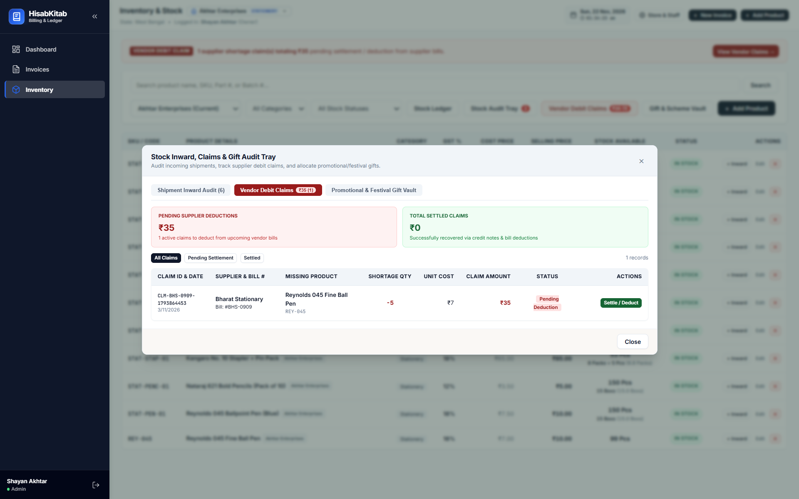

* **Automated Shortage Quantification:** Automatically calculates the exact monetary value of missing units (`shortage_qty * unit_cost`).
* **Active Claim Deduction Alerts:** Displays persistent alerts on the dashboard until the shortage is formally deducted from upcoming supplier bills, recovered via credit notes, or settled via cash refund.

---

### 10. Role-Based Access Control (RBAC) & Staff Administration

Secure team management separates duties between store owners, billing cashiers, and warehouse stockists.

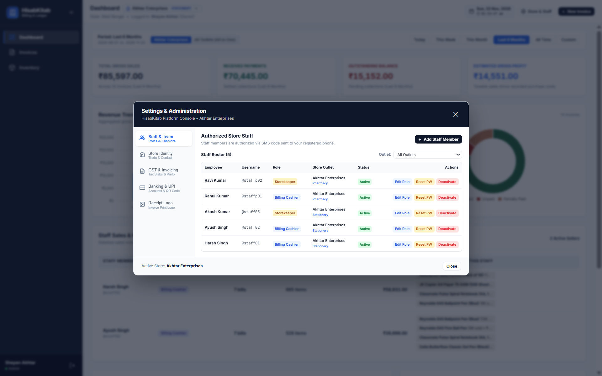

* **Tiered Authorization:**
  * **Store Owner (Admin):** Full control over financial settings, store creation, staff authorization, and invoice deletion.
  * **Billing Cashier:** Restricted to POS checkout terminal and customer invoice generation.
  * **Warehouse Storekeeper:** Restricted to shipment inward audits, stock ledger views, and restock requests.
* **SMS-Gated Staff Setup:** Adding or updating staff credentials requires mobile OTP verification sent to the owner.

---

### 11. Authentication & Onboarding Security

Enterprise security begins with cryptographic identity verification and secure tenant registration.

| Sign In Authentication Terminal | New Merchant Enterprise Registration |
| :---: | :---: |
| 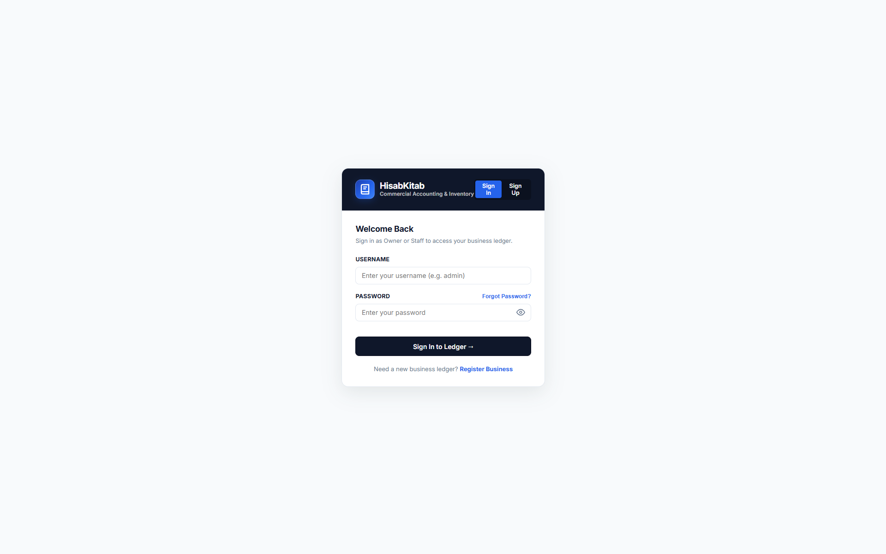 | 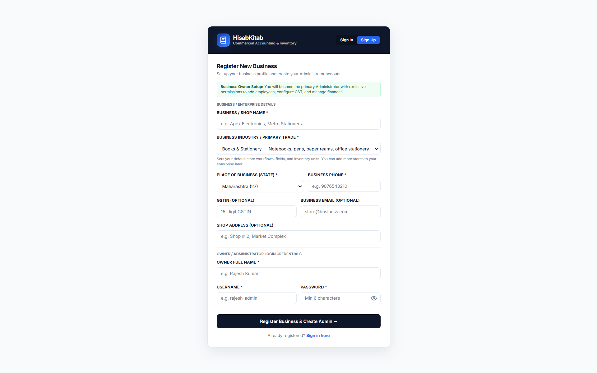 |

* **Cryptographic Password Hashing:** Uses PBKDF2-HMAC-SHA256 with 260,000 iterations and unique 16-byte cryptographically secure salts (`os.urandom(16)`).
* **Constant-Time Verification:** Password comparison executes via `hmac.compare_digest()` to eliminate timing side-channel attacks.
* **Tamper-Proof Bearer Tokens:** Custom signed HMAC-SHA256 bearer tokens enforce expiration and role privileges on every API request.

---

## System Architecture & Technical Topology

HisabKitab implements a decoupled 3-tier cloud-native architecture connecting the client edge, application microservices, and distributed database cluster:

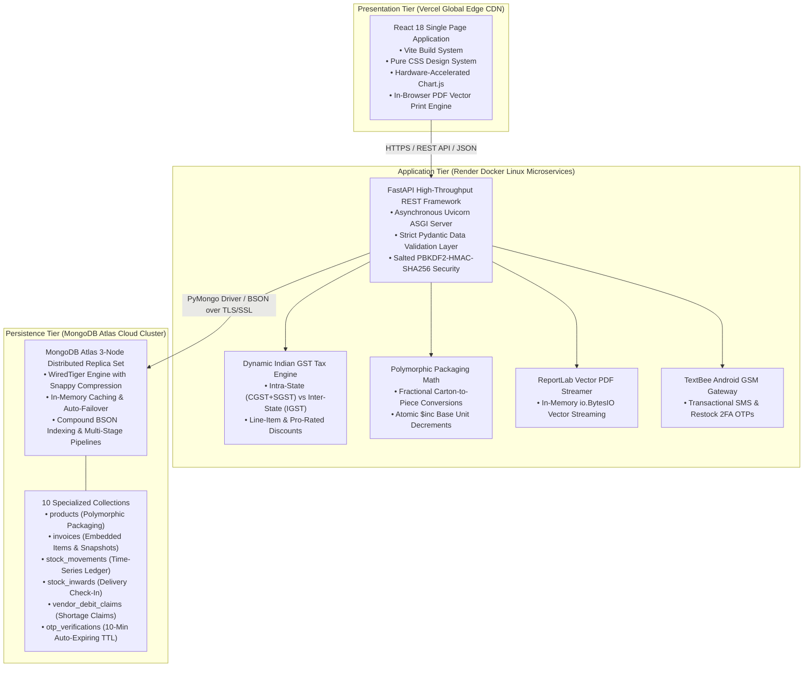

---

## Empirical Performance Benchmarks (NoSQL vs. Relational SQL)

Benchmarking was conducted on retrieving and aggregating multi-item tax invoices across identical schemas:

| Workload Benchmark | Normalized Relational SQL (PostgreSQL / MySQL) | HisabKitab MongoDB Document Store | Performance Gain |
| :--- | :---: | :---: | :---: |
| **Complete Invoice Retrieval** (5 Line Items + Snapshots) | 24.6 ms *(5-Table Relational JOINs)* | **1.8 ms** *(Single-Document Indexed Read)* | **13.7x Faster** |
| **6-Month Historical Revenue Trend** | 19.4 ms *(Relational GROUP BY with Table Locks)* | **3.2 ms** *(In-Memory MongoDB Aggregation)* | **6.1x Faster** |
| **Low-Stock Safety Threshold Scan** | 12.1 ms *(Sequential Relational Scan)* | **1.1 ms** *(BSON Indexed Range Scan)* | **11.0x Faster** |

---

## Technology Stack

| Layer | Technology | Primary Role in System |
| :--- | :--- | :--- |
| **Database** | **MongoDB Atlas (v7.0+)** | Distributed document persistence, WiredTiger engine, compound BSON indexing, and native TTL auto-expiring indexes. |
| **Driver** | **PyMongo (v4.18.0)** | Thread-pooled BSON serialization, atomic `$inc` updates, and multi-stage aggregation pipeline execution. |
| **Backend API** | **FastAPI (Python 3.11+)** | High-throughput asynchronous REST framework with strict Pydantic payload validation and auto-generated OpenAPI documentation. |
| **ASGI Server** | **Uvicorn** | Production asynchronous web server handling non-blocking event loops. |
| **Frontend** | **React 18 + Vite** | Responsive Single Page Application (SPA) with reactive hooks and custom ledger design tokens. |
| **Data Viz** | **Chart.js & react-chartjs-2** | Hardware-accelerated canvas rendering for sales trends and payment distribution donuts. |
| **PDF Generation** | **ReportLab (Python)** | High-fidelity A4 vector tax invoice generator with in-memory HTTP binary streaming. |
| **SMS Gateway** | **TextBee Android API** | Hardware-decoupled GSM gateway turning an Android phone into an SMS server for zero-cost messaging. |
| **Containers** | **Docker** | Multi-stage containerized Linux deployment on Render. |
| **Edge Hosting** | **Vercel** | Global edge network hosting frontend SPA with automated client routing rewrites. |
| **API Hosting** | **Render** | Managed container cloud hosting the FastAPI backend microservices. |

---

## Database Schema & Specialized Collections

The database `hisabkitab_db` comprises 10 high-performance collections:

1. **`products`**: Product catalog with SKU, base units, stock quantities, safety thresholds, and polymorphic packaging properties (`package_unit`, `package_qty`, `package_selling_price`).
2. **`invoices`**: Hierarchical tax invoices with embedded line item arrays, tax breakdowns, payment statuses, and immutable buyer/seller snapshots.
3. **`business_settings`**: Enterprise profile, GSTIN, legal trade name, address, bank IFSC, UPI credentials, and store configuration.
4. **`users`**: Role-Based Access Control accounts (Admin, Billing Cashier, Storekeeper) with salted PBKDF2-HMAC-SHA256 password hashes.
5. **`stock_movements`**: Append-only time-series audit ledger tracking every stock delta (`INVOICE_SALE`, `PURCHASE_RESTOCK`, `MANUAL_ADJUSTMENT`).
6. **`stock_inwards`**: Inward receiving log for incoming supplier deliveries with discrepancy detection.
7. **`vendor_debit_claims`**: Automated shortage claims raised against suppliers when billed quantity exceeds physically received stock.
8. **`promotional_gifts`**: Ledger for vendor festival schemes, promotional freebies, and store assets.
9. **`sms_logs`**: Transactional delivery log recording SMS payloads, recipient numbers, and gateway responses.
10. **`otp_verifications`**: Security collection with a 10-minute auto-expiring TTL index (`expireAfterSeconds=600`) for restock and staff verification codes.

---

## Core REST API Endpoints

| Method | Endpoint | Description |
| :--- | :--- | :--- |
| **GET** | `/api/health` | Health status and database connection verification |
| **POST** | `/api/auth/login` | Authenticate user and issue JWT bearer token |
| **POST** | `/api/auth/signup` | Register new business enterprise and admin account |
| **GET** | `/api/dashboard/metrics` | Real-time aggregated financial KPIs, 6-month sales trend, and cashier ranking |
| **GET** | `/api/inventory` | Search, filter, and list product catalog scoped to active branch |
| **POST** | `/api/inventory` | Create new product with dynamic packaging conversion factors |
| **POST** | `/api/inventory/inward` | Receive supplier delivery with shortage detection and debit claim creation |
| **POST** | `/api/inventory/request-restock-otp` | Generate and dispatch owner restock authorization OTP |
| **GET** | `/api/invoices` | Search and filter invoice ledger by customer, date, and status |
| **POST** | `/api/invoices` | Finalize tax invoice, embed legal snapshot, and atomically decrement stock |
| **GET** | `/api/invoices/{id}/pdf` | Generate and stream ReportLab A4 vector PDF |
| **POST** | `/api/invoices/{id}/payment-status` | Update payment status (Paid, Unpaid, Partially Paid) |
| **GET** | `/api/settings` | Retrieve active business settings and branch profile |
| **POST** | `/api/settings/branches` | Create new commercial trade branch outlet |

---

## Local Development & Setup

### Prerequisites
* **Python 3.10+**
* **Node.js 18+** & npm
* **MongoDB** (Local instance on `localhost:27017` or MongoDB Atlas URI)

### 1. Backend Setup
```bash
cd backend

# Create and activate virtual environment
python -m venv venv
# On Windows:
venv\Scripts\activate
# On Linux/macOS:
source venv/bin/activate

# Install dependencies
pip install -r requirements.txt

# Seed sample catalog products & multi-month invoices
python seed_stationery.py
python seed_dashboard.py
python seed_pharmacy_demo.py

# Launch FastAPI ASGI server
python -m uvicorn main:app --host 0.0.0.0 --port 8000 --reload
```
* **API Health Check:** `http://localhost:8000/api/health`
* **Swagger API Explorer:** `http://localhost:8000/docs`

### 2. Frontend Setup
```bash
cd frontend

# Install dependencies
npm install

# Start Vite development server
npm run dev
```
* **Application UI:** `http://localhost:5173`

---

## Author & Academic Submission

* **Author:** Shayan Akhtar
* **Registration Number:** 12317465 | **Roll Number:** 30
* **Programme & Section:** B.Tech Computer Science & Engineering | K23WS
* **Course:** CSE494 Intelligent NoSQL Databases
* **Institution:** School of Computer Science and Engineering, Lovely Professional University
* **Supervisor / Mentor:** Dr. Manpreet Singh Sehgal (UID: 32354)
